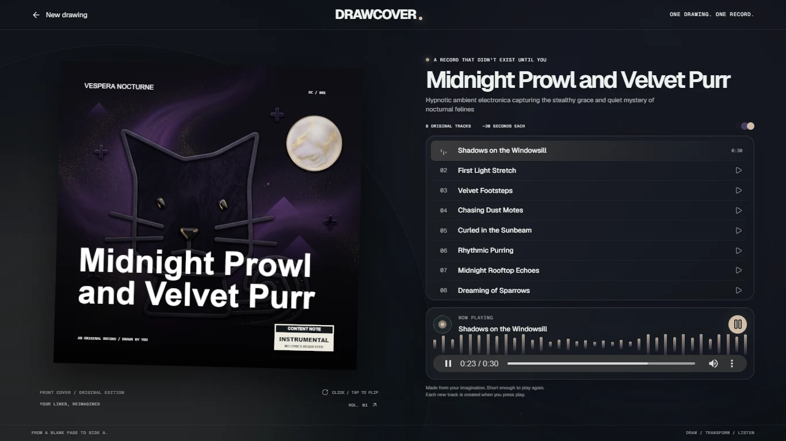
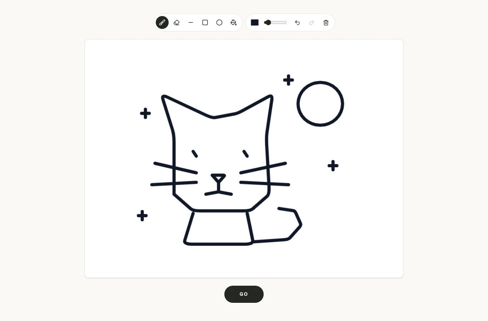

<div align="center">

# DrawCover

### Draw a little. Drop a record.

A sketch becomes cover art, a fictional artist, eight track titles, and a sound of its own.

**No prompt box. No guessing game. Just draw, then PRESS RECORD.**

[Try DrawCover](https://drawcover.oeng.dev) &nbsp; / &nbsp; [See it in motion](#the-demo) &nbsp; / &nbsp; [Run it locally](#quick-start)



</div>

DrawCover turns your drawing into a small music release. The AI interprets the sketch
without announcing its guess, reimagines it as artwork, and builds a coordinated album.
The first **~30-second track** starts automatically; the other seven are made only when
you choose them. Flip the record, explore its printed back cover, and keep listening
from the separate player.

### Critic mode

The subtle bottom-right **Critic mode** link opens [/play](https://drawcover.oeng.dev/play).
An original, modeled 3D critic arrives on the left; desktop drawing controls shift right.
On mobile a compact model sits above the canvas. Changing critics
with the above-head reload button is free and keeps the drawing. **Normal mode** returns
to the centered studio; reduced motion removes the entrance/exit animations. Without
WebGL the game keeps its accessible controls and written review, with a small unavailable
message instead of a duplicate 2D character.

Guess a fictional critic's taste from their outfit and props, then press record with
either Instrumental or Lyrics selected. **Reveal verdict** shows a score out of 10,
an in-character written review, and the musical preferences behind it. These are
**concept reviews, not audio listening**: server-only rules score the generated musical
direction (4 points), mood (3) and sleeve palette (3). No critic is modeled on a real
person; scores are deterministic rather than random.

One immutable review is included in each game album's existing reservation, so the
shared **25 albums/day and 40 tracks/day** caps and personal abuse cooldown still apply.
There is no extra paid review call or public rescoring endpoint. Album ID, selected
critic, vocal mode, cached result and recovery receipt stay bound together; repeating
reads cannot spend or reinterpret the verdict. Another round returns to the drawing
with a new critic; another generated album uses the normal album allowance.

Sound is **on by default**, unlocked by the first click, draw stroke or key press.
The discoverable mute control remembers the choice in this browser. Each critic has
a different, original oscillator voice; no
recordings, speech service or AI credits are used. Mouth/gesture bursts, gentle idles
and review poses remain optional decoration. Music playback stops babble, revealing
a verdict pauses music, and mute, hidden tabs, critic changes and navigation stop it.
Short speech bubbles greet and react; the review appears in the same bubble.
Text reveals alongside short, character-triggered syllables and can be tapped to
show it instantly. Muting or playing music silences babble without stopping or restarting
the reveal. Reduced motion shows all text immediately; screen readers receive the full
message once, not individual letters. All scores and reviews are usable silently.

> **One Google Gemini key is enough. One OpenRouter key also works.**
> Prefer different providers for artwork and music? Configure each capability separately.
> Keys belong in your local server environment, never in the browser.

## Try it online

**Public demo address: [drawcover.oeng.dev](https://drawcover.oeng.dev).**
Deployment/setup status is available [here](https://drawcover.oeng.dev/api/drawcover/status).
If generation is unavailable, the demo may still need its server key, be busy, or have
reached its daily allowance. You never need to supply a key to the public website.
The daily allowance is **site-wide**: other visitors can use it before your first album.
It is not a day-long ban on your account or network.

The full app runs on **Cloudflare Workers**, not GitHub Pages. GitHub Pages cannot host
the server routes or safely use a repository secret in browser JavaScript.
The public demo uses OpenRouter only, with per-network limits and strict global
generation-request caps; [self-hosting instructions](#deploy-your-own-cloudflare-demo)
are below. Local installations can still use direct Gemini, OpenRouter or mixed providers.

## The demo

[](docs/media/drawcover-demo.mp4)

**[Watch/download the 48-second video with music](docs/media/drawcover-demo.mp4)**
&nbsp; · &nbsp;
**[Listen to the complete first track](docs/media/first-track.mp3)**

This is a **real run**, captured on November 17, 2026: *Midnight Prowl and Velvet Purr*
by the generated fictional artist *Vespera Nocturne*. No mocked provider responses.
One album and one music track were generated using direct Gemini:
`gemini-3.5-flash-lite`, `gemini-3.1-flash-image`, and `lyria-3-clip-preview`.

The video cuts idle/generation waits and speeds up the drawing segment to 1.6x.
Its soundtrack is the actual generated first track, added during editing rather than
recorded from system audio. The GIF is a **silent, 2x overview** of that edited video
(about 5 MB). Screenshots reuse the same real result; they do not spend more credits.
[Capture details](docs/media/demo-evidence.json).
The historical recording/screenshots predate the **PRESS RECORD** label and custom favicon.

## From a blank page to side A

| 1. Make your mark | 2. PRESS RECORD |
|---|---|
|  |  |
| Brush, erase, draw shapes, fill areas, change ink and size, undo or redo. Rough is fine. | The subject stays behind the scenes. Album details and artwork are generated first; track 1 follows. |

| 3. Meet your record | 4. Turn it over |
|---|---|
|  |  |
| The whole room takes on the album's palette. If autoplay is blocked, press play. | Click/tap the artwork, or focus it and press Enter/Space. The printed tracks are decorative; use the player beside it. |

<details>
<summary><strong>On a smaller screen</strong></summary>
<br />


The layout stacks and scrolls naturally. Desktop and laptop results fit the viewport;
the track panel can scroll internally when space is tight. Reduced motion or unavailable
WebGL uses a flat cover with a gentle crossfade instead of tilt and 3D rotation.
</details>

### A record, not just an image

- **A recognizable remix.** Image-to-image generation receives the original drawing.
  If artwork generation fails, a clearly identified local color remix keeps the flow usable.
- **A physical front and back.** Three.js adds depth, pointer tilt and a real flip.
  The covers carry the generated title and fictional artist, plus coordinated printed details.
- **Eight titles, no eight-track bill up front.** Track 1 is automatic. Tracks 2–8 generate
  lazily on first play; cached replays do not make another provider request.
- **A world built from the palette.** Glass-style surfaces, ambient color, a waveform player,
  Canvas UI particle reveal and restrained sparks.
- **Controls that remain controls.** Keyboard flip, ordinary track buttons and native audio
  controls; no cursor-following overlays over the tracklist.
  The floating GitHub button in the bottom-left opens this repository in a new tab.
- **A studio with a sense of humor.** Recording messages rotate while artwork is pending,
  without repeated screen-reader announcements or pretend progress percentages.

The cover's **content note** reflects the selected vocal mode: instrumental music or
vocals with original lyrics were requested. It is not an official
age rating, a certified clean-content guarantee, or a fabricated Parental Advisory warning.

## Quick start

**Requirements:** Git and **Node.js 22.12+ on the 22.x LTS line, or Node.js 24 LTS**.
You need provider access and billing/credits for AI artwork and music.
No database or separate backend service is required.

```sh
git clone https://github.com/oliverseges/DrawCover.git
cd DrawCover
npm install
```

Copy the empty configuration template:

```powershell
# PowerShell
Copy-Item .env.example .env
```

```sh
# macOS / Linux
cp .env.example .env
```

Open `.env` in your editor. Add **either** `GEMINI_API_KEY` **or** `OPENROUTER_API_KEY`;
leave unused keys and optional overrides empty. Then:

```sh
npm run dev
```

Open **http://localhost:3000**, draw something, choose **Instrumental** (the default) or
**Lyrics**, and press **PRESS RECORD**. Lyrics mode chooses a familiar drawing-appropriate
genre such as pop, rock, hip-hop, country or dance and requests a short sung verse/chorus
with original lyrics, rather than an ambient instrumental. The choice stays with the
album and every lazily generated track; returning to the drawing lets you choose again.
If the port is taken, use `npm run dev -- -p 3001` and open http://localhost:3001.
Restart the server after changing environment variables.

`.env` and `.env.local` are ignored by Git. `.env.local` also works and takes precedence;
avoid putting conflicting values in both. **Never prefix a key with `NEXT_PUBLIC_`.**

<details>
<summary><strong>Production build / reproducible install</strong></summary>

```sh
npm ci
npm run build
npm start
```

Set the same server-side environment variables in your hosting platform. Use a Node.js
runtime and request-duration limits long enough for AI generation. The app does not ship
authentication, per-user billing or durable storage; see [privacy and deployment](#privacy-and-deployment)
before exposing a paid instance.
</details>

### Lyrics support

The existing Lyria 3 Clip model supports vocals and generated lyrics:
[Google's music guide](https://aistudio.google.com/docs/music-generation) documents the
30-second clip, lyrics/structure output and text-prompt Interactions request.
OpenRouter exposes the same [`google/lyria-3-clip-preview`](https://openrouter.ai/google/lyria-3-clip-preview)
model through its [streaming text/audio format](https://openrouter.ai/docs/guides/overview/multimodal/audio).
No additional provider, lyric-writing call or longer-song model is used.

Lyrics mode is enabled only for the documented clip IDs: `lyria-3-clip-preview` with
direct Gemini, or `google/lyria-3-clip-preview` with OpenRouter. An unverified local music
model override fails before any paid album work, with the exact environment setting to
fix; Instrumental remains available. Old requests and albums without a vocal-mode field
remain instrumental and keep their existing cache keys. Lyrical albums use separate
generation/recovery entries, never an instrumental cache hit for the same drawing.
Vocals/lyrical fidelity depend on the provider; the content note records what was
requested, not an audio audit or a clean/explicit certification. No paid vocal generation
is used by the automated checks.

## Bring your own key

These are **server configuration choices**, not a client-side key-entry form.
An OpenRouter key is not required when you use Google's direct APIs.

| Setup | What to set | What works |
|---|---|---|
| **Direct Google only** | `GEMINI_API_KEY` from [Google AI Studio](https://aistudio.google.com/apikey) | Recognition, album details, image editing and direct Lyria music. Enable billing and the required model access. |
| **OpenRouter only** | `OPENROUTER_API_KEY` from [OpenRouter](https://openrouter.ai/keys) | Vision-based album details, image editing and Lyria music through one router key. Add credits. |
| **Both keys, defaults** | Both keys; provider overrides empty | Gemini details; Gemini artwork with OpenRouter image fallback; OpenRouter music. This preserves the original routing. |
| **Mixed, your choice** | Both keys plus the selectors below | Choose metadata, artwork and music independently. An explicit provider will not silently spend at the other one. |
| **Local cover remix** | A metadata key, plus `DRAWCOVER_IMAGE_PROVIDER=drawing` | Skips paid image generation. Metadata and music still use their selected providers. |

### Routing and models

All selectors and model overrides are optional. The complete, commented list is in
[`.env.example`](.env.example); all of its values are intentionally empty.

| Capability | Provider selector | Default with both keys | Model overrides and defaults |
|---|---|---|---|
| Private interpretation + album details | `DRAWCOVER_METADATA_PROVIDER` | `auto` → Gemini | Direct: `DRAWCOVER_METADATA_MODEL` → `GEMINI_MODEL` → `gemini-3.5-flash-lite`. Router: `OPENROUTER_METADATA_MODEL` → `google/gemini-3.5-flash-lite`. |
| Cover transformation | `DRAWCOVER_IMAGE_PROVIDER` | `auto` → Gemini, then OpenRouter if configured, then local remix | Direct: `DRAWCOVER_IMAGE_MODEL` → `gemini-3.1-flash-image`. Router: `OPENROUTER_IMAGE_MODEL` → `google/gemini-3.1-flash-image`. |
| Short music | `DRAWCOVER_MUSIC_PROVIDER` | `auto` → OpenRouter | Direct: `DRAWCOVER_MUSIC_MODEL` → `lyria-3-clip-preview`. Router: `OPENROUTER_MUSIC_MODEL` → `google/lyria-3-clip-preview`. |

Provider selectors accept `auto`, `gemini`, or `openrouter`; the image selector also
accepts `drawing`. With only one key, automatic routing uses that provider. Explicit
image selection still falls back to the local drawing remix if that provider fails,
but **does not call the other image provider**. Music has no automatic cross-provider
retry. Missing metadata/music keys and invalid selectors produce configuration errors
rather than silently switching a paid request; an unavailable image key uses the
same clearly identified drawing fallback as other artwork failures.

For example, with both keys configured, use Google's direct music API while keeping
automatic artwork fallback:

```dotenv
DRAWCOVER_METADATA_PROVIDER=gemini
DRAWCOVER_IMAGE_PROVIDER=auto
DRAWCOVER_MUSIC_PROVIDER=gemini
```

Direct music uses Google's documented [Interactions API for Lyria](https://ai.google.dev/gemini-api/docs/music-generation),
not text-to-speech or a real-time stream pretending to be a song. Direct requests set
`store: false`. OpenRouter uses its [audio-output API](https://openrouter.ai/docs/guides/overview/multimodal/audio).
Override models only with compatible capabilities: vision + structured JSON for routed
metadata, **image input and output** for covers, and **MP3 music output** for tracks.
A speech model is not a music substitute. Model availability varies by account and region.

### Cost and timing

**PRESS RECORD is a paid action once keys are configured.** It generates album details and artwork,
then automatically requests track 1. Selecting an unmade track is another paid music call.

As checked on November 17, 2026, both
[Google's pricing](https://ai.google.dev/gemini-api/docs/pricing) and the
[OpenRouter Lyria page](https://openrouter.ai/google/lyria-3-clip-preview) list the
30-second clip at **US$0.04 per song**: $0.04 for the first track, or $0.32 if you
generate all eight, **plus metadata and artwork costs**. Prices, taxes, credit fees,
quotas and model access can change; consult the provider's current pricing.

Generation is not instant. The recorded run took about **13 seconds for the album**
and another **13 seconds for track 1**, not counting drawing/rendering time. This is
an example, not a latency promise. There are no automatic retry loops.

## How it fits together

```mermaid
flowchart LR
    Draw["Browser: canvas + PRESS RECORD"] --> Album["Next.js: album route"]
    Album --> Details["Gemini direct or OpenRouter vision"]
    Details --> Cover["Image editing or local drawing remix"]
    Cover --> Record["Themed front/back record + 8 titles"]
    Record --> Play["First track / choose an unmade track"]
    Play --> Music["Next.js: track route"]
    Music --> Lyria["Lyria via Gemini direct or OpenRouter"]
    Lyria --> Player["Browser: cached audio + native controls"]
```



**Stack:** Next.js App Router, React, TypeScript, Tailwind CSS, shadcn/ui, Zustand,
Three.js, Canvas UI, Google Gen AI SDK, Vitest and Playwright.
All provider calls and keys stay on the server. Metadata is validated before display;
artwork/audio responses are bounded. Opaque album IDs keep arbitrary prompts out of
the track endpoint.

The important seams are `lib/drawcover-config.ts` (routing), `lib/drawcover-server.ts`
(generation and bounded caches), `lib/drawcover-image.ts` (cover fallback),
`components/drawcover.tsx` (the experience), and `components/physical-album.tsx`
(Three.js lifecycle). There is no permanent album library.

### The original DrawSound

DrawCover is the home page; the earlier **DrawSound**
drawing-to-sound experiment remains at `/drawsound`. That legacy route uses
`GEMINI_API_KEY` / `GEMINI_MODEL` for recognition and licensed Wikimedia recordings
or Web Audio synthesis for playback. Its optional AI-audio button still uses
`OPENROUTER_API_KEY` / `OPENROUTER_SFX_MODEL`, independently of the DrawCover selectors.
Lyria is a music model, not a dedicated realistic sound-effects model.

## Development and tests

```sh
npm run lint
npm run typecheck
npm test
npx playwright install chromium
npm run test:e2e
npm run build
```

For the actual Workers runtime, also run `npm run cf:build` then `npm run test:workers`.
This regression drives the upload bundle and SQLite Durable Object with **all outbound
provider traffic mocked**, including replay, daily-cap and personal-cooldown checks.
Its native-browser loop truncates real HTTP album/music responses and requires one-click
playback, free recovery and unchanged reservations after reload/concurrent reads. Set
`WORKER_SLOW_PROBE=true` when running `node tests/workers/browser.mjs` for a 50-second
provider-stream probe instead of the fast scenarios.

Unit tests mock providers. Browser tests mock generation endpoints: **tests spend no AI
credits**. They cover provider combinations/fallback, invalid configuration, cache and
error behavior, drawing → PRESS RECORD → playback, keyboard/touch flipping, reduced-motion/WebGL
fallback, and desktop viewport fit.

To reuse the local :3001 server instead of starting the test server:

```powershell
$env:E2E_BASE_URL = "http://localhost:3001"
npm run test:e2e
```

## Troubleshooting

| Symptom | What to check |
|---|---|
| PRESS RECORD is disabled | Add at least one mark to the canvas. |
| Configuration error | Add the selected provider's key to `.env`, use a supported selector, and restart. Check for an overriding `.env.local` or shell variable. |
| Artwork is a drawing remix | Billing, image-model access, region, safety filtering or a provider failure may prevent AI artwork. `auto` tries configured image providers; explicit selection does not. Server logs contain redacted image diagnostics. |
| Cover appears, but a track fails | Check music billing/credits and model access. The album stays usable and the affected track has its own error state. Recent failures are cached for about two minutes. |
| No sound | Press the visible play control; browsers can block autoplay. Check volume and the native player's controls. |
| Album unavailable or expired | Caches are memory-only and expire after about 30 minutes. A restart, eviction or another server instance can invalidate an album ID. Create a new record. |
| No particles or 3D tilt | This is an intentional compatibility/accessibility fallback. Canvas UI native HTML capture needs Chrome 157+; other browsers retain ordinary content. Reduced motion disables animated embellishments. |
| Install fails on an older Node release | Use Node 22.12+ LTS or 24 LTS, then `npm ci`. |

## Privacy and deployment

Drawing stays local until **PRESS RECORD**. Then the selected provider receives the drawing or
its interpretation; image providers receive the original drawing. Music providers
receive the album theme and track title. Keys are read from server environment variables,
never sent to the browser. Do not draw sensitive or confidential material.

DrawCover does not write a persistent album database or upload your result to a gallery.
Its temporary server cache is **not** a promise of zero provider retention: review
[Google's terms](https://ai.google.dev/gemini-api/terms) and
[OpenRouter's privacy policy](https://openrouter.ai/privacy), including your plan,
region, age and permitted-use requirements.

**This is a local creative experiment, not a hardened public paid service.** Before
hosting it for other people, add authentication, per-user budgets/rate limits, appropriate
abuse controls and a deliberate storage/deployment design. A public source repository
does not make it safe to expose an unrestricted server backed by your keys.
Dependency advisories are not currently zero: review `npm audit` and upstream updates
before deployment. The showcase is not a security certification.

### Deploy your own Cloudflare demo

This repository includes an [OpenNext adapter](https://opennext.js.org/cloudflare),
[`wrangler.jsonc`](wrangler.jsonc), and a
[GitHub Actions deployment](.github/workflows/deploy-cloudflare.yml).
OpenNext 1.20.17 supports this Next.js 16 version, App Router and route handlers.
It uses `nodejs_compat` and `global_fetch_strictly_public` with compatibility date
`2026-11-18`. Cloudflare currently recommends vinext for new apps; this existing Next.js
app deliberately uses the documented OpenNext deployment path.
Cache Components/partial prefetching are disabled only for the Workers build: the
uncached static shell avoids a workerd rendering hang. `npm run dev` is unchanged.

**Account and hostname**

Create a Cloudflare account, activate your domain as a Cloudflare zone, and select a
Workers plan that fits the deployed bundle and usage. Review Workers and Durable Objects
pricing; AI request caps do not cap Cloudflare hosting charges. The current deployment
uses Workers Free: its CPU/request quotas still apply and may require a plan change for
reliable larger generations. No billing plan is upgraded by this repository. Set your own `account_id`,
Worker `name`, matching `WORKER_SELF_REFERENCE.service`, and custom-domain `routes` in
`wrangler.jsonc` if forking. The checked-in values target this project's account and
`drawcover.oeng.dev`; do not deploy those unchanged to another account. Wrangler creates
the custom-domain DNS and certificate; do not overwrite a hostname used by another service.

**Automatic deployment**

In Cloudflare, create an API token using **Edit Cloudflare Workers**, scoped to your
target account and zone. The permissions needed for this configuration are:

| Scope | Permission | Purpose |
|---|---|---|
| Account, target account only | **Workers Scripts: Edit** | Upload Worker/assets, SQLite Durable Object migrations/bindings, secrets and custom-domain association. |
| Account, target account only | **Account Settings: Read** | Resolve/verify the selected account. |
| Zone, target zone only | **Zone: Read** | Resolve the active custom-domain zone. |
| Zone, target zone only | **Workers Routes: Edit** | Manage Worker domain/routing configuration. |

No R2/KV/D1 resources, global API key or signing secret are required. The private Durable
Object binding is the trusted state boundary; browsers receive opaque album IDs, not
unsigned generation prompts. See the [official CI guide](https://developers.cloudflare.com/workers/ci-cd/external-cicd/github-actions/)
and [custom-domain API permissions](https://developers.cloudflare.com/api/resources/workers/subresources/domains/methods/update/).

Add these **GitHub repository secrets** under Settings → Secrets and variables → Actions:

| Secret | Where it comes from |
|---|---|
| `OPENROUTER_API_KEY` | Your OpenRouter key, preferably with a small provider-side hard credit/spend limit. |
| `CLOUDFLARE_API_TOKEN` | The scoped token above; never put it in a file committed to Git. |
| `CLOUDFLARE_ACCOUNT_ID` | Cloudflare dashboard account ID. |

Push to `main` or run **Actions → Deploy DrawCover → Run workflow**. Missing secrets cause
a clean skip with an explanatory notice, not a half-configured deploy. The key is passed
only to the deploy step. If the Worker has no key yet, it is written to a runner-temporary
restricted file, seeded as a **Worker Secret alongside the code**, then the file is removed.
An existing Worker key is preserved, not overwritten from GitHub or local `.env`.
It is not provided to the build or browser. OAuth/MCP login does not configure GitHub Actions.

**First manual deployment**

```sh
npm ci
npm run cf:build
npx wrangler login
npm run cf:deploy
```

Then open **Cloudflare → Workers & Pages → drawcover → Settings → Variables and Secrets**,
add `OPENROUTER_API_KEY` as a **Secret**, and deploy the change. Alternatively,
`npx wrangler secret put OPENROUTER_API_KEY` prompts securely in your terminal.
The GitHub repository secret cannot be read back by Wrangler; these are separate stores.
Do not paste any key into the website, README, issues or chat. Until the Worker secret
exists, generation fails closed with 503. Existing Worker secrets are preserved by manual
code deploys and CI. Rotate an existing production key in Cloudflare's Worker settings.

After deployment, the URL is `https://drawcover.<your-workers-subdomain>.workers.dev`
and, once its certificate is ready, your configured custom domain. The read-only
`/api/drawcover/status` endpoint reports whether bindings/key are configured, never their
values. It checks configuration, **not** provider credit balance or model access.

**Public-demo protections and storage**

- Per-IP/network: **2 album requests and 8 track requests per 60 seconds**. Cloudflare's
  [Rate Limiting binding](https://developers.cloudflare.com/workers/runtime-apis/bindings/rate-limit/)
  is approximate per location; shared networks can share the allowance. Exceeding either
  threshold starts a **15-minute network cooldown**, shared across locations in the Durable
  Object. Denied attempts do not extend it. A Sonner toast shows the actual remaining time;
  server 429 responses include `reason: "cooldown"`, `Retry-After` and `retryAfterSeconds`.
  The DO stores a hash of the network IP only for the cooldown, not the raw address.
- Globally: **25 album generations + 40 track generations per UTC day**, reserved
  atomically in one named SQLite Durable Object before paid work. Failures count;
  cached results do not. These are **request caps, not guaranteed dollar spending limits**.
  At most one metadata call plus one image call per album, and one music call per track;
  provider prices can change. Daily exhaustion uses `reason: "daily_limit"` and a distinct
  shared-allowance toast, with the wait until midnight UTC in hours/minutes.
  Limit notices remain readable until dismissed, never stack duplicates, and are not
  personal day-long timeouts.
  Also use a restricted OpenRouter key and account alerts.
- At most **2 albums and 4 tracks generating concurrently** worldwide. Duplicate
  in-flight requests return 409; no second paid job starts. Leases expire after four
  minutes, failures cache for two minutes, successful results are available for 30 minutes.
- The Durable Object stores album details/artwork and generated audio, so IDs and cached
  tracks survive isolate changes and deployments. An alarm removes expired application
  records; Cloudflare's SQLite backups/PITR can retain prior data under its retention
  policy. This is not a permanent personal library or authentication system.
- Input PNGs are bounded to 4 MiB decoded, JSON bodies are streamed with byte/time limits,
  and track requests to 1 KiB. Invalid requests do not reserve paid work. Hosted models
  are fixed to the documented OpenRouter defaults; local provider/model overrides cannot
  silently switch hosted billing. Legacy recognition and AI-sound endpoints are disabled.

Caps live in `wrangler.jsonc`: `DRAWCOVER_DAILY_ALBUM_LIMIT` and
`DRAWCOVER_DAILY_TRACK_LIMIT`. Set both to `"0"` to pause new paid work. Invalid/missing
caps fail closed; supported maxima are 100/400 per day. Changing names/DO IDs resets the
state boundary, so do not rotate them to bypass counters. Redeploy after editing limits.
Rate thresholds are the two `ratelimits` bindings. All protection failures return clear
429/503 messages; same-origin checks are defense-in-depth, not authentication.
Local `next dev` / `next start` enforce the same 2/8-per-minute and 15-minute cooldown
in a single process-wide development bucket, rather than trusting spoofable client IP
headers. Everyone sharing a local server shares that bucket. Public per-IP limits and
strict global daily counters use the hosted Cloudflare bindings; restarting a local
process clears its local cooldown, not the hosted Durable Object.
The read-only `/api/drawcover/status` endpoint includes the shared day's `used`,
`limits` and `resetsAt` values. It reveals no keys, drawings, album IDs or visitor IPs.
Status checks, in-flight duplicate requests and cached generation reads do not reserve
another paid generation. Invalid input and missing provider configuration are rejected
before reserving; once a provider request is attempted, failures conservatively count.

Browser requests have a deadline covering both headers **and response bodies** (120 seconds
for artwork/metadata, 75 seconds for music), so a lost response cannot leave playback
permanently stuck on MAKING. A deliberate Retry checks the same album/track cache;
interrupted responses now automatically recover through a **read-only recording receipt**,
without replaying the POST. Recovery polls pending work for at most another 120 seconds
(75 for music), with at most three consecutive transport failures. These reads cannot
call a provider, reserve credits or trigger the generation cooldown. The opaque receipt
survives hosted Worker restarts for 30 minutes and cannot be reused for different work.
Expired/missing receipts and cached provider failures are reported, never regenerated
automatically. Browser/network interruption can occur after server work finishes; recovery
does not make platform-terminated or failed provider work succeed. Request IDs and sanitized
timing/outcome logs help correlate browser transport errors with Worker completion.
A failed provider attempt is cached for two minutes to avoid
immediate repeated spending; a subsequent deliberate attempt may cost another generation.

For local Workers validation, run `npm run cf:build` then
`npm run cf:preview -- --port 8787`. Use an ignored `.dev.vars` for explicit preview
secrets if needed; real requests still cost money. The build removes private `.env`
values from OpenNext's generated env module, so your workstation keys are not silently
packaged for deployment. No live AI is required for tests.

**Further hardening:** add [Turnstile](https://developers.cloudflare.com/turnstile/get-started/)
with server-side token verification, authentication or Cloudflare Access if you need more
than a small anonymous trial. Turnstile is not enabled by default and is not a replacement
for the strict request caps. Existing dependency advisories still need maintenance.

## Credits, media and licensing

- **Canvas UI** by David Haz supplies ParticleReveal and Blaze, installed through its
  [official registry](https://canvasui.dev/docs/installation). Its license is
  **MIT + Commons Clause**, not unmodified MIT. The required notice and component
  redistribution restriction are preserved in [`components/canvasui/LICENSE.md`](components/canvasui/LICENSE.md).
- **Three.js** supplies physical rendering; **React**, **Next.js**, **Tailwind CSS**,
  **Zustand** and **shadcn/ui** supply the app/UI foundation. Their dependency licenses
  continue to apply. See the [Three.js notice](docs/licenses/Three-MIT.txt).
- **Lucide** supplies icons ([ISC](https://github.com/lucide-icons/lucide/blob/main/LICENSE));
  the GitHub mark is from [Primer Octicons](https://github.com/primer/octicons)
  ([MIT notice](docs/licenses/Octicons-MIT.txt)).
  **Geist / Geist Mono**, by Vercel and basement.studio, supply typography
  ([SIL Open Font License 1.1](docs/licenses/Geist-OFL.txt)).
- **Google Gemini and Lyria**, used directly or via **OpenRouter**, generate the demo
  artwork, fictional album metadata and music. The demo sketch was drawn for this
  project; recording used Playwright and editing used FFmpeg. No Wikimedia audio is
  included in the DrawCover demo. Generated content is subject to provider terms and
  applicable rights; uniqueness, copyright protection and commercial clearance are
  **not** guaranteed.
- **Wikimedia Commons contributors** provide optional recordings only in the legacy
  DrawSound experience. Each selected file's author, source and individual license are
  shown in that UI; keep those credits when reusing a recording.

**No project-wide source or demo-media license has been selected yet.** Public visibility
alone is not a blanket license to reuse this project's own code or media. Third-party
notices above are not a new license for DrawCover. Ask the maintainer about reuse.

## Contributing

Found a rough edge? [Open an issue](https://github.com/oliverseges/DrawCover/issues)
with reproduction steps, browser/viewport, provider/model names and a screenshot if useful.
**Never include API keys, `.env`, authenticated request dumps or private drawings.**
For changes, keep the drawing screen minimal, preserve keyboard/reduced-motion behavior,
use mocked providers in tests, and run the checks above. Discuss broader changes and
licensing with the maintainer before starting.
