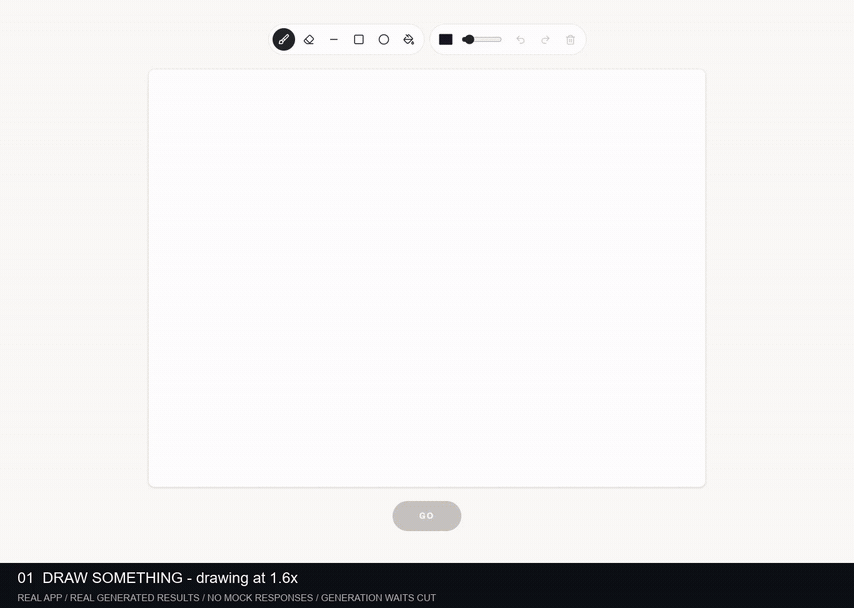
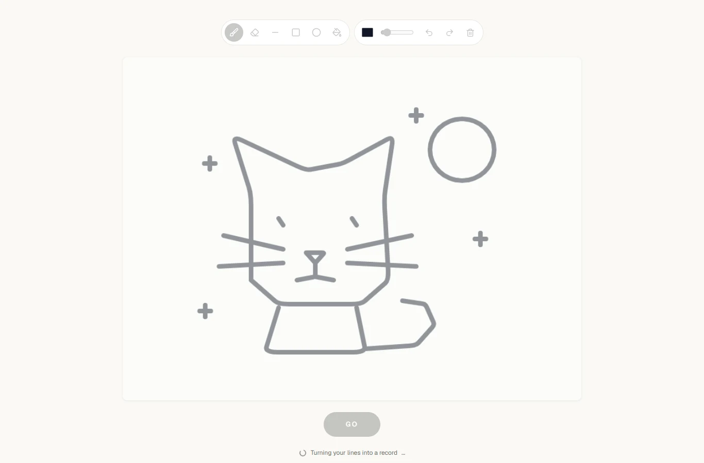
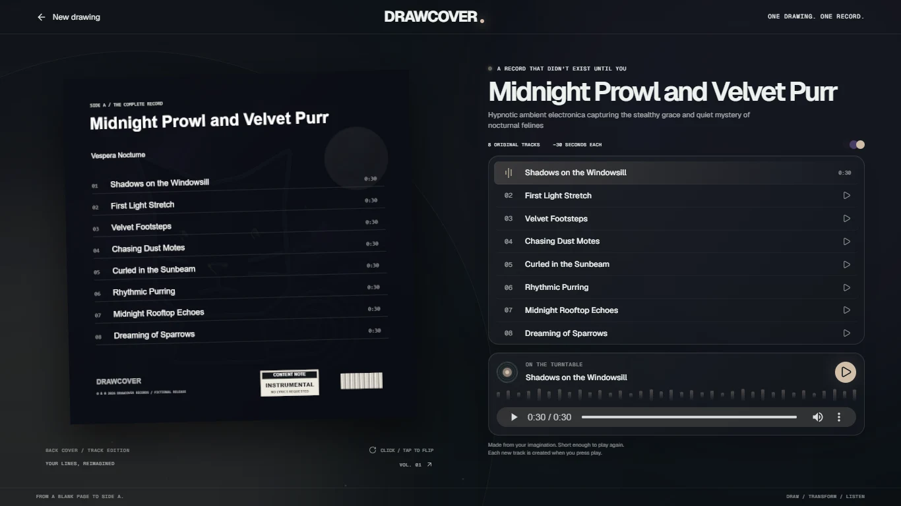
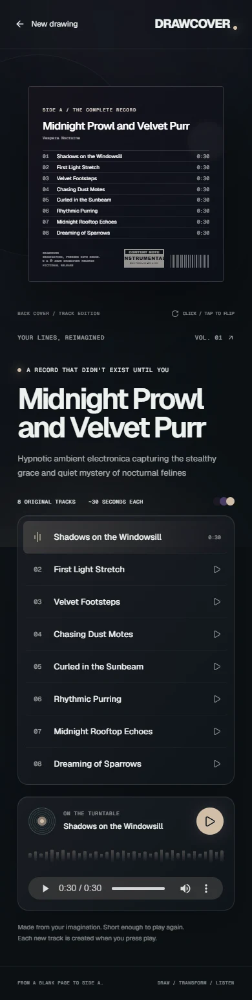

<div align="center">

# DrawCover

### Draw a little. Drop a record.

A sketch becomes cover art, a fictional artist, eight track titles, and a sound of its own.

**No prompt box. No guessing game. Just draw, then GO.**

[See it in motion](#the-demo) &nbsp; / &nbsp; [Run it locally](#quick-start) &nbsp; / &nbsp; [Choose your provider](#bring-your-own-key)


</div>

DrawCover turns your drawing into a small music release. The AI interprets the sketch
without announcing its guess, reimagines it as artwork, and builds a coordinated album.
The first **~30-second track** starts automatically; the other seven are made only when
you choose them. Flip the record, explore its printed back cover, and keep listening
from the separate player.

> **One Google Gemini key is enough. One OpenRouter key also works.**
> Prefer different providers for artwork and music? Configure each capability separately.
> Keys belong in your local server environment, never in the browser.

## The demo

[](docs/media/drawcover-demo.mp4)

**[Watch/download the 48-second video with music](docs/media/drawcover-demo.mp4)**
&nbsp; · &nbsp;
**[Listen to the complete first track](docs/media/first-track.mp3)**

This is a **real run**, captured on November 17, 2026: *Midnight Prowl and Velvet Purr*
by the generated fictional artist *Vespera Nocturne*. No mocked provider responses.
One album and one music track were generated using direct Gemini:
`gemini-3.5-flash-lite`, `gemini-3.1-flash-image`, and `lyria-3-clip-preview`.

The video cuts idle/generation waits and speeds up the drawing segment to 1.6x.
Its soundtrack is the actual generated first track, added during editing rather than
recorded from system audio. The GIF is a **silent, 2x overview** of that edited video
(about 5 MB). Screenshots reuse the same real result; they do not spend more credits.
[Capture details](docs/media/demo-evidence.json).

## From a blank page to side A

| 1. Make your mark | 2. Press GO |
|---|---|
|  |  |
| Brush, erase, draw shapes, fill areas, change ink and size, undo or redo. Rough is fine. | The subject stays behind the scenes. Album details and artwork are generated first; track 1 follows. |

| 3. Meet your record | 4. Turn it over |
|---|---|
|  |  |
| The whole room takes on the album's palette. If autoplay is blocked, press play. | Click/tap the artwork, or focus it and press Enter/Space. The printed tracks are decorative; use the player beside it. |

<details>
<summary><strong>On a smaller screen</strong></summary>
<br />


The layout stacks and scrolls naturally. Desktop and laptop results fit the viewport;
the track panel can scroll internally when space is tight. Reduced motion or unavailable
WebGL uses a flat cover with a gentle crossfade instead of tilt and 3D rotation.
</details>

### A record, not just an image

- **A recognizable remix.** Image-to-image generation receives the original drawing.
  If artwork generation fails, a clearly identified local color remix keeps the flow usable.
- **A physical front and back.** Three.js adds depth, pointer tilt and a real flip.
  The covers carry the generated title and fictional artist, plus coordinated printed details.
- **Eight titles, no eight-track bill up front.** Track 1 is automatic. Tracks 2–8 generate
  lazily on first play; cached replays do not make another provider request.
- **A world built from the palette.** Glass-style surfaces, ambient color, a waveform player,
  Canvas UI particle reveal and restrained sparks.
- **Controls that remain controls.** Keyboard flip, ordinary track buttons and native audio
  controls; no cursor-following overlays over the tracklist.

The cover's **content note** says instrumental music was requested. It is not an official
age rating, a certified clean-content guarantee, or a fabricated Parental Advisory warning.

## Quick start

**Requirements:** Git and **Node.js 22.12+ on the 22.x LTS line, or Node.js 24 LTS**.
You need provider access and billing/credits for AI artwork and music.
No database or separate backend service is required.

```sh
git clone https://github.com/oliverseges/DrawSound.git
cd DrawSound
npm install
```

Copy the empty configuration template:

```powershell
# PowerShell
Copy-Item .env.example .env
```

```sh
# macOS / Linux
cp .env.example .env
```

Open `.env` in your editor. Add **either** `GEMINI_API_KEY` **or** `OPENROUTER_API_KEY`;
leave unused keys and optional overrides empty. Then:

```sh
npm run dev
```

Open **http://localhost:3000**, draw something, and press **GO**.
If the port is taken, use `npm run dev -- -p 3001` and open http://localhost:3001.
Restart the server after changing environment variables.

`.env` and `.env.local` are ignored by Git. `.env.local` also works and takes precedence;
avoid putting conflicting values in both. **Never prefix a key with `NEXT_PUBLIC_`.**

<details>
<summary><strong>Production build / reproducible install</strong></summary>

```sh
npm ci
npm run build
npm start
```

Set the same server-side environment variables in your hosting platform. Use a Node.js
runtime and request-duration limits long enough for AI generation. The app does not ship
authentication, per-user billing or durable storage; see [privacy and deployment](#privacy-and-deployment)
before exposing a paid instance.
</details>

## Bring your own key

These are **server configuration choices**, not a client-side key-entry form.
An OpenRouter key is not required when you use Google's direct APIs.

| Setup | What to set | What works |
|---|---|---|
| **Direct Google only** | `GEMINI_API_KEY` from [Google AI Studio](https://aistudio.google.com/apikey) | Recognition, album details, image editing and direct Lyria music. Enable billing and the required model access. |
| **OpenRouter only** | `OPENROUTER_API_KEY` from [OpenRouter](https://openrouter.ai/keys) | Vision-based album details, image editing and Lyria music through one router key. Add credits. |
| **Both keys, defaults** | Both keys; provider overrides empty | Gemini details; Gemini artwork with OpenRouter image fallback; OpenRouter music. This preserves the original routing. |
| **Mixed, your choice** | Both keys plus the selectors below | Choose metadata, artwork and music independently. An explicit provider will not silently spend at the other one. |
| **Local cover remix** | A metadata key, plus `DRAWCOVER_IMAGE_PROVIDER=drawing` | Skips paid image generation. Metadata and music still use their selected providers. |

### Routing and models

All selectors and model overrides are optional. The complete, commented list is in
[`.env.example`](.env.example); all of its values are intentionally empty.

| Capability | Provider selector | Default with both keys | Model overrides and defaults |
|---|---|---|---|
| Private interpretation + album details | `DRAWCOVER_METADATA_PROVIDER` | `auto` → Gemini | Direct: `DRAWCOVER_METADATA_MODEL` → `GEMINI_MODEL` → `gemini-3.5-flash-lite`. Router: `OPENROUTER_METADATA_MODEL` → `google/gemini-3.5-flash-lite`. |
| Cover transformation | `DRAWCOVER_IMAGE_PROVIDER` | `auto` → Gemini, then OpenRouter if configured, then local remix | Direct: `DRAWCOVER_IMAGE_MODEL` → `gemini-3.1-flash-image`. Router: `OPENROUTER_IMAGE_MODEL` → `google/gemini-3.1-flash-image`. |
| Short music | `DRAWCOVER_MUSIC_PROVIDER` | `auto` → OpenRouter | Direct: `DRAWCOVER_MUSIC_MODEL` → `lyria-3-clip-preview`. Router: `OPENROUTER_MUSIC_MODEL` → `google/lyria-3-clip-preview`. |

Provider selectors accept `auto`, `gemini`, or `openrouter`; the image selector also
accepts `drawing`. With only one key, automatic routing uses that provider. Explicit
image selection still falls back to the local drawing remix if that provider fails,
but **does not call the other image provider**. Music has no automatic cross-provider
retry. Missing metadata/music keys and invalid selectors produce configuration errors
rather than silently switching a paid request; an unavailable image key uses the
same clearly identified drawing fallback as other artwork failures.

For example, with both keys configured, use Google's direct music API while keeping
automatic artwork fallback:

```dotenv
DRAWCOVER_METADATA_PROVIDER=gemini
DRAWCOVER_IMAGE_PROVIDER=auto
DRAWCOVER_MUSIC_PROVIDER=gemini
```

Direct music uses Google's documented [Interactions API for Lyria](https://ai.google.dev/gemini-api/docs/music-generation),
not text-to-speech or a real-time stream pretending to be a song. Direct requests set
`store: false`. OpenRouter uses its [audio-output API](https://openrouter.ai/docs/guides/overview/multimodal/audio).
Override models only with compatible capabilities: vision + structured JSON for routed
metadata, **image input and output** for covers, and **MP3 music output** for tracks.
A speech model is not a music substitute. Model availability varies by account and region.

### Cost and timing

**GO is a paid action once keys are configured.** It generates album details and artwork,
then automatically requests track 1. Selecting an unmade track is another paid music call.

As checked on November 17, 2026, both
[Google's pricing](https://ai.google.dev/gemini-api/docs/pricing) and the
[OpenRouter Lyria page](https://openrouter.ai/google/lyria-3-clip-preview) list the
30-second clip at **US$0.04 per song**: $0.04 for the first track, or $0.32 if you
generate all eight, **plus metadata and artwork costs**. Prices, taxes, credit fees,
quotas and model access can change; consult the provider's current pricing.

Generation is not instant. The recorded run took about **13 seconds for the album**
and another **13 seconds for track 1**, not counting drawing/rendering time. This is
an example, not a latency promise. There are no automatic retry loops.

## How it fits together

```mermaid
flowchart LR
    Draw["Browser: canvas + GO"] --> Album["Next.js: album route"]
    Album --> Details["Gemini direct or OpenRouter vision"]
    Details --> Cover["Image editing or local drawing remix"]
    Cover --> Record["Themed front/back record + 8 titles"]
    Record --> Play["First track / choose an unmade track"]
    Play --> Music["Next.js: track route"]
    Music --> Lyria["Lyria via Gemini direct or OpenRouter"]
    Lyria --> Player["Browser: cached audio + native controls"]
```



**Stack:** Next.js App Router, React, TypeScript, Tailwind CSS, shadcn/ui, Zustand,
Three.js, Canvas UI, Google Gen AI SDK, Vitest and Playwright.
All provider calls and keys stay on the server. Metadata is validated before display;
artwork/audio responses are bounded. Opaque album IDs keep arbitrary prompts out of
the track endpoint.

The important seams are `lib/drawcover-config.ts` (routing), `lib/drawcover-server.ts`
(generation and bounded caches), `lib/drawcover-image.ts` (cover fallback),
`components/drawcover.tsx` (the experience), and `components/physical-album.tsx`
(Three.js lifecycle). There is no permanent album library.

### The original DrawSound

The repository is still named **DrawSound**. DrawCover is the home page; the earlier
drawing-to-sound experiment remains at `/drawsound`. That legacy route uses
`GEMINI_API_KEY` / `GEMINI_MODEL` for recognition and licensed Wikimedia recordings
or Web Audio synthesis for playback. Its optional AI-audio button still uses
`OPENROUTER_API_KEY` / `OPENROUTER_SFX_MODEL`, independently of the DrawCover selectors.
Lyria is a music model, not a dedicated realistic sound-effects model.

## Development and tests

```sh
npm run lint
npm run typecheck
npm test
npx playwright install chromium
npm run test:e2e
npm run build
```

Unit tests mock providers. Browser tests mock generation endpoints: **tests spend no AI
credits**. They cover provider combinations/fallback, invalid configuration, cache and
error behavior, drawing → GO → playback, keyboard/touch flipping, reduced-motion/WebGL
fallback, and desktop viewport fit.

To reuse the local :3001 server instead of starting the test server:

```powershell
$env:E2E_BASE_URL = "http://localhost:3001"
npm run test:e2e
```

## Troubleshooting

| Symptom | What to check |
|---|---|
| GO is disabled | Add at least one mark to the canvas. |
| Configuration error | Add the selected provider's key to `.env`, use a supported selector, and restart. Check for an overriding `.env.local` or shell variable. |
| Artwork is a drawing remix | Billing, image-model access, region, safety filtering or a provider failure may prevent AI artwork. `auto` tries configured image providers; explicit selection does not. Server logs contain redacted image diagnostics. |
| Cover appears, but a track fails | Check music billing/credits and model access. The album stays usable and the affected track has its own error state. Recent failures are cached for about two minutes. |
| No sound | Press the visible play control; browsers can block autoplay. Check volume and the native player's controls. |
| Album unavailable or expired | Caches are memory-only and expire after about 30 minutes. A restart, eviction or another server instance can invalidate an album ID. Create a new record. |
| No particles or 3D tilt | This is an intentional compatibility/accessibility fallback. Canvas UI native HTML capture needs Chrome 157+; other browsers retain ordinary content. Reduced motion disables animated embellishments. |
| Install fails on an older Node release | Use Node 22.12+ LTS or 24 LTS, then `npm ci`. |

## Privacy and deployment

Drawing stays local until **GO**. Then the selected provider receives the drawing or
its interpretation; image providers receive the original drawing. Music providers
receive the album theme and track title. Keys are read from server environment variables,
never sent to the browser. Do not draw sensitive or confidential material.

DrawCover does not write a persistent album database or upload your result to a gallery.
Its temporary server cache is **not** a promise of zero provider retention: review
[Google's terms](https://ai.google.dev/gemini-api/terms) and
[OpenRouter's privacy policy](https://openrouter.ai/privacy), including your plan,
region, age and permitted-use requirements.

**This is a local creative experiment, not a hardened public paid service.** Before
hosting it for other people, add authentication, per-user budgets/rate limits, appropriate
abuse controls and a deliberate storage/deployment design. A public source repository
does not make it safe to expose an unrestricted server backed by your keys.
Dependency advisories are not currently zero: review `npm audit` and upstream updates
before deployment. The showcase is not a security certification.

## Credits, media and licensing

- **Canvas UI** by David Haz supplies ParticleReveal and Blaze, installed through its
  [official registry](https://canvasui.dev/docs/installation). Its license is
  **MIT + Commons Clause**, not unmodified MIT. The required notice and component
  redistribution restriction are preserved in [`components/canvasui/LICENSE.md`](components/canvasui/LICENSE.md).
- **Three.js** supplies physical rendering; **React**, **Next.js**, **Tailwind CSS**,
  **Zustand** and **shadcn/ui** supply the app/UI foundation. Their dependency licenses
  continue to apply. See the [Three.js notice](docs/licenses/Three-MIT.txt).
- **Lucide** supplies icons ([ISC](https://github.com/lucide-icons/lucide/blob/main/LICENSE));
  **Geist / Geist Mono**, by Vercel and basement.studio, supply typography
  ([SIL Open Font License 1.1](docs/licenses/Geist-OFL.txt)).
- **Google Gemini and Lyria**, used directly or via **OpenRouter**, generate the demo
  artwork, fictional album metadata and music. The demo sketch was drawn for this
  project; recording used Playwright and editing used FFmpeg. No Wikimedia audio is
  included in the DrawCover demo. Generated content is subject to provider terms and
  applicable rights; uniqueness, copyright protection and commercial clearance are
  **not** guaranteed.
- **Wikimedia Commons contributors** provide optional recordings only in the legacy
  DrawSound experience. Each selected file's author, source and individual license are
  shown in that UI; keep those credits when reusing a recording.

**No project-wide source or demo-media license has been selected yet.** Public visibility
alone is not a blanket license to reuse this project's own code or media. Third-party
notices above are not a new license for DrawCover. Ask the maintainer about reuse.

## Contributing

Found a rough edge? [Open an issue](https://github.com/oliverseges/DrawSound/issues)
with reproduction steps, browser/viewport, provider/model names and a screenshot if useful.
**Never include API keys, `.env`, authenticated request dumps or private drawings.**
For changes, keep the drawing screen minimal, preserve keyboard/reduced-motion behavior,
use mocked providers in tests, and run the checks above. Discuss broader changes and
licensing with the maintainer before starting.
